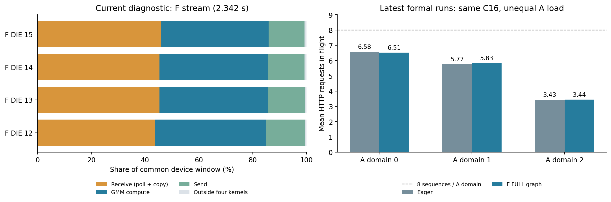

# F FULL graph 为什么没有明显端到端收益

该目录是机制诊断，正式性能来自 [2026-10-11 全量](../../results/2026-10-11/REPORT.zh-CN.md)。

现有证据最支持：F 主机规划和提交成本大部分已被设备执行覆盖。graph 更早交完工作，随后等待设备与 A/F 逐层数据依赖；主机同步等得久，不等于存在同样长的可消除设备间隙。

新诊断使用当前 host 修复基线，256 会话各前四轮、1,024 请求，全部成功。保持 12A+4F、异步调度/CAM、两份 token 微批次及 C16。第 515 条完成后启用既有 profiler。所有 16 worker 共同设备窗口 2.341965 秒；关联请求缓存采用约 66.97%，不代表全量后期高命中阶段。

| 当前共同窗口测量 | 范围 |
|---|---:|
| F 接收内核（含 poll 与搬运） | 43.60%–45.96% |
| F 两段 GMM | 39.90%–41.45% |
| F 发送内核 | 13.44%–14.26% |
| 四类主内核之外 | 0.695%–0.706% |
| 其中 15 个 43-work-item 边界的间隙 | 0.291%–0.303% |

“四类主内核之外”可能含小 DMA，是空闲上界，不能称作设备利用率。同步边界包含在其中，不重复相加。43 次是 connector 工作项，可混合 A 域、层和微批次，不等于一个 A 批次刚好完成 43 层。

完整 F 采样中每 worker 主机同步等待约 3.89 秒，边界流间隙却仅约 10.4–10.8 ms。直接删同步不能回收整段等待，也不能自动并行具有数据依赖的事务。局部占比不能机械换算成全量收益上限。

同期 A 代表 DIE 的非通信设备工作并集约 70.4%–87.3%，与 TP 通信有重叠。没有逐 CAM job 的就绪时刻，也未分离接收的 poll/搬运，无法对 A 计算、TP、CAM 分配严格因果份额。

正式全量的全局 C16 约 97% 时间满载，AFD 三域平均 HTTP 在途约 6.51、5.83、3.44。HTTP 在途不等于 NPU 利用率；它显示固定会话亲和下域间供给不同，F 提交优化不能自动平衡。

可研究候选是 A 的 CombineRecv → Add → HcPost → 下一微批次 DispatchSend 尾段，代表 DIE 约占窗口 1.2%–2.1%。但 native 缓冲没有任意独立微批次槽，不能直接提前两次 dispatch。没有提交生产计算改动，没有获得原 9,078 请求全量验证的优化收益。

- [当前窗口数值](window-summary.json)
- [正式逐请求分层](latest-formal-analysis.json)
- [诊断核对](current-diagnostic-audit.json)
- [旧基线机制材料](../../archive/old-f-graph-timeline.md)

profiler 收尾扰动过回放；这里选所有 worker 捕获交叠窗口，仍不能消除 profiler 影响。原大体积 trace 留在原证据存储，当前目录不提供未授权的内网下载地址。
