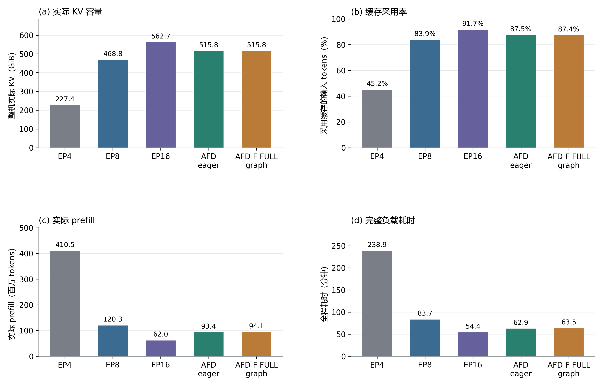
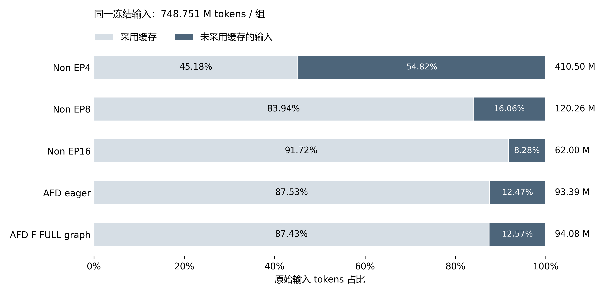
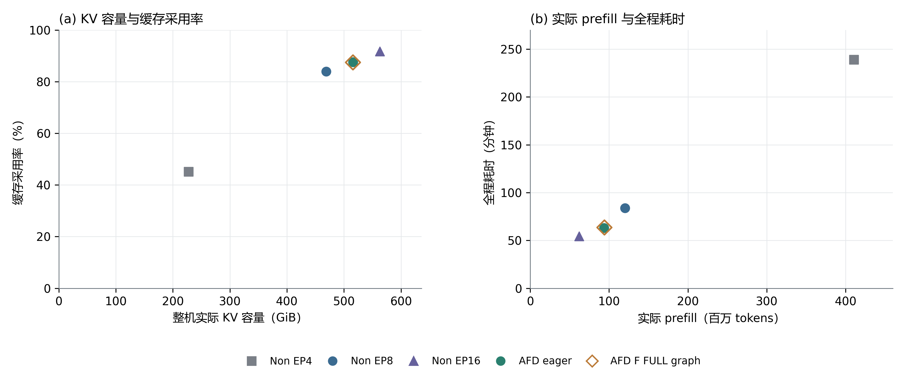

# 五组部署实验：KV 缓存、实际计算与完成时间

实验日期：2026 年 10 月 11–12 日。报告日期：2026 年 10 月 12 日。

**在同一冻结长上下文负载和每组 16 DIE 的资源预算下，新增的 Non EP16 单实例取得最短的完整负载耗时：54.416 分钟。** 旧统一基线中，AFD eager 比 Non EP8 快 24.84%；加入 EP16 后，Non EP16 又比 AFD eager 快 13.51%。因此，已验证的“AFD 优于 EP8”是那两套部署的实测结果，不能推广为 AFD 必然优于继续扩大专家并行的 Non 部署。五组均各运行一次完整负载，旧四组原始数值保持不变。

## 设计与可比条件

五组使用相同 W4A8 模型、公共 vLLM/Ascend 基线及已验证的 Compressor host 修复，各独占 16 DIE。负载为同一冻结清单的 256 个完整会话、9,078 条请求，原始输入 748,751,397 tokens，输出固定 1 token；客户端全局最多 16 条在途 HTTP 请求。Non 三组共用四域会话路由和 MBT8192，AFD 两组共用三域路由和 MBT32768。EP16 仅增加单实例 DP4/TP4/EP16 拓扑、四个 DP rank 的端点映射及必要记录路径；相对已审计的 Non EP4 命令，其余计算与性能参数一致。

| 部署 | 16 DIE 拓扑 | KV 域 | MBT | 执行模式 |
| --- | --- | ---: | ---: | --- |
| Non EP4 | 4×DP1/TP4/EP4 | 4 | 8,192 | eager |
| Non EP8 | 2×DP2/TP4/EP8 | 4 | 8,192 | eager |
| Non EP16 | 1×DP4/TP4/EP16 | 4 | 8,192 | eager |
| AFD eager | 12A+4F；A DP3/TP4，F DP4/TP1/EP4 | 3 | 32,768 | A/F eager |
| AFD F FULL graph | 同上 | 3 | 32,768 | A eager、F FULL graph |

共同设置包括 max model length 262,144、block size 32、每域 max sequences 8、显存利用率目标 0.9、checkpoint ratio 0.25、prefix caching、chunked prefill 和显式异步调度。正式负载均从冷缓存开始，不带 profiler。EP16 事前记录了完整启动命令、环境、16 个 worker 的有效环境与加载库，四域异步调度和冷 reset 基线均通过核对；一次正式回放成功完成全部 9,078 条，零抢占、零正式重试。

公共软件基线为 vLLM `d02df748bf9efd99022f1a062597dc3cb3808485`、vLLM Ascend `52411eb0dec8b3b3d05e8bdf5a9adb7698fb80c5` 加 PR #4 固定 head `5cfb1697cf570b3bae2e30f9cc76d9e4e8bb5f46` 与原包补丁；AFD 两组使用 `cda849a5e0a54576472096c0073f00c7095726f5`。本次 EP16 沿用已验证 Non 运行时及修复 host，CANN 9.1.0；没有引入新计算代码。[实际启动参数与环境](../../experiments/2026-10-12-ep16/recorded-configuration.json)、[发压前审计](audits/prepressure.json)和[版本基线](../../environment/versions.json)可复核。完整机器记录按原目录保留，公开字段见 [来源映射](sources.json)。

## 五组结果

| 部署 | 全机实际 KV GiB | 缓存采用率 | 实际 prefill tokens | 全程分钟 |
| --- | ---: | ---: | ---: | ---: |
| Non EP4 | 227.381 | 45.1760% | 410,495,525 | 238.924 |
| Non EP8 | 468.838 | 83.9384% | 120,261,157 | 83.714 |
| **Non EP16** | **562.675** | **91.7196%** | **61,999,653** | **54.416** |
| AFD eager | 515.779 | 87.5270% | 93,391,397 | 62.917 |
| AFD F FULL graph | 515.767 | 87.4346% | 94,083,621 | 63.488 |

全机 KV 为 16 DIE 上实际独立 tensor storage 之和，包含 TP 驻留副本；采用率是采用缓存的 tokens / 全部原始输入 tokens，并非命中请求比例。实际 prefill 来自服务端原生 `request_finished`。五组均无抢占重算，因而每组满足 `原始输入 = 采用缓存 + 实际 prefill`。全程耗时从第一个 HTTP 发送到最后一个 SSE 完成，包含这段期间的依赖等待和准入排队，不含启动、profile 与冷 reset。[五组完整指标](metrics.csv)和[逐域容量](per-domain-capacity.csv)给出原值。

图 1｜相同输入与资源预算下的五组部署结果。[矢量版](figures/fig01_five_arm_overview.svg)

## 容量如何影响历史复用

从 Non EP8 到 Non EP16，四个 KV 域及会话路由不变。EP16 的实际 KV 从 468.838 增至 562.675 GiB（+20.01%），缓存采用率从 83.9384% 升至 91.7196%（+7.7812 个百分点）；实际 prefill 减少 58,261,504 tokens（−48.45%），全程耗时减少 35.00%。这组比较支持更大的可用 KV 与更多历史复用、较少实际计算共同出现，但 EP8→EP16 同时改变了专家布局与通信，不能从这一次部署比较中单独估计 KV 容量的因果贡献。

AFD eager 的每个 A DIE 实际 KV 约 42.981 GiB，高于 EP16 的 35.167 GiB；AFD 只有 12 个 A DIE、3 个 KV 域，而 EP16 的 16 个 DIE、4 个域都承载 KV。本次测量中 EP16 的整机 KV 高 9.09%，每域会话压力也不同：冻结路由将 Non 的 256 会话均分为每域 64 个，AFD 三域分别为 85、86、85 个。AFD 每域约 57,100 个 KV block，EP16 每域约 46,718–46,719 个；总量分别约 171,299 和 186,874 个。EP16 相对 AFD eager 的缓存采用率高 4.1925 个百分点，实际 prefill 少 31,391,744 tokens（−33.61%），全程耗时短 8.502 分钟（−13.51%）。这说明 AFD 的较高**单 DIE** KV 容量不能代替整机容量、域数及路由压力来判断本负载的缓存效果。[逐 DIE HBM、权重与 KV](per-die-memory.csv)保留了每个设备的原值。

不能仅由“F 不存 KV”推导 AFD 总 KV 较少或 F 显存被浪费：F 承载专家也会释放 A 侧权重空间。这里观察到的是最终容量和负载分布的差异；MBT、通信、工作区等对显存分配的独立贡献尚未确认。HBM 使用量减去权重与 KV 的差额也不能直接标为单独测量的 activation/workspace。

图 2｜同一 748.751 百万 token 输入的缓存采用比例；右侧为实际 prefill。五组均无重算，因此未采用缓存的输入与实际 prefill 数量相同。[矢量版](figures/fig02_five_arm_cache_prefill_partition.svg)

图 3｜每个点是一套部署的一次完整实测。相近的 AFD eager 和 F FULL graph 以实心圆、空心菱形区分。[矢量版](figures/fig03_five_arm_relationships.svg)

## 完成效率与请求延迟

| 指标 | Non EP4 | Non EP8 | Non EP16 | AFD eager | AFD F FULL graph |
| --- | ---: | ---: | ---: | ---: | ---: |
| 吞吐，请求/秒 | 0.633 | 1.807 | **2.780** | 2.405 | 2.383 |
| TTFT 均值，秒 | 24.993 | 8.775 | **5.671** | 6.556 | 6.618 |
| TTFT P50，秒 | 15.376 | 4.016 | 4.047 | **3.834** | 3.849 |
| TTFT P95，秒 | 79.615 | 33.513 | **14.822** | 23.645 | 24.393 |
| TTFT P99，秒 | 147.311 | 53.484 | **30.866** | 50.774 | 50.566 |
| E2E 均值，秒 | 24.994 | 8.778 | **5.676** | 6.559 | 6.622 |
| E2E P50，秒 | 15.377 | 4.017 | 4.055 | **3.836** | 3.853 |
| E2E P95，秒 | 79.617 | 33.515 | **14.827** | 23.646 | 24.395 |
| E2E P99，秒 | 147.312 | 53.489 | **30.874** | 50.776 | 50.568 |

EP16 的全程效率、均值和尾部延迟在本次五组中最好，但 AFD eager 的请求延迟中位数略低。按相同请求 ID 和原始 prompt 配对，EP16 相比 AFD eager 有 3,763/9,078 条请求 E2E 更短，其余 5,315 条更长；配对 E2E 比值中位数为 1.187。完整负载更快与多数请求的单独 E2E 不更短可以同时成立：逐请求计时从其实际 HTTP 发送开始，排除了该请求之前的依赖与 C16 准入等待；全程则包含这些等待。不同配置的完成时刻还会改变就绪顺序、组批和缓存状态。[同请求描述性比较](paired-ep16.csv)只用于显示分布，不把共享调度下的请求视为独立重复实验。

## bench 如何并发和调度

回放运行真实 AgentInfer analyzer、planner、依赖图和 SSE transport。冻结记录保留每个会话的原始 token IDs 及全部轮次；人工时间戳只重建同一会话的前后顺序，回放等待间隔设为零，本轮生成不回填下一轮。256 个会话同时进入依赖图，下一轮必须等上一轮发送与上下文依赖完成。

客户端准入器在**所有已经就绪的请求**中按冻结优先级选择，最多保持 16 个未完成的 HTTP/SSE 请求；没有按缓存域设置串行客户端队列。同一会话固定路由到一个 KV 域。Non EP16 的四域分别是同一实例的 DP rank 0–3；服务端各域独立使用实际观察到的 `CompressorCheckpointAsyncScheduler`，按每域 seq8、MBT8192 和可用 KV 组织执行。客户端 C16 与服务端每域 seq8 是不同层次的约束，异步调度也不会取消会话依赖。

逐请求 TTFT 从 AgentInfer 开始发送（正文序列化前）至首个生成 token，E2E 从同一起点至 SSE 完成；两者不包含该请求发送前的依赖与准入等待。全程从首个发送至最后完成。正式入口先确认端点空闲，对每个独立 HTTP 端点冷 reset，再保存各域原生计数和端点 metrics 基线。EP16 是 1 个 reset 端点、4 份域基线。[完整 bench 方法与实现链接](../../docs/bench-method.md)列出负载构建、准入和审计细节。

## 结论与证据边界

新 EP16 结果说明：在本次同一负载下，扩大 Non 专家并行也能获得比原 EP8 和两组 AFD 更高的整机 KV、更高的缓存采用、更少的实际 prefill 与更短的全程耗时。此前 AFD 相对 EP8 的 1.331× 加速仍是可信的**既定部署比较**，但不是 AFD 机制相对所有 Non 拓扑的普遍优势。EP16 相对 AFD eager 的全程加速为 1.156×；AFD F FULL graph 相对 eager 仍未显示额外全程收益。容量、采用、prefill 与耗时在五组上方向一致；专家布局、通信、MBT、域数和动态组批同时变化，现有实验不能把 1.156× 精确拆分为其中某一项的贡献。

EP16 的本地与远端审计覆盖 9,078 条 HTTP 与原生域结果、冻结输入 SHA、256 会话、四域路由、优先级、16 worker 修复 host、发压前有效环境及冷基线；配置差异记录仅发现 DP/设备范围与运行记录路径的预期变化。[EP16 配置核对](../../experiments/2026-10-12-ep16/configuration-comparison.json)、[EP16 结果与审计索引](summaries/non_ep16.json)、[旧四组原始指标](../2026-10-11/metrics.csv)和[公开证据索引](README.md)可追溯各项结论。正式运行完成后的自有服务停止记录在原归档保留；这不代表资源当前状态。

公开补充前的独立复核见 [review.json](review.json)：逐请求核对冻结身份、HTTP/native 一一对应、C16、优先级、会话依赖及全部指标，旧四组数值不变。该审计确认执行与统计一致性，不等同于全量数值精度测试。每组一次运行，不作统计显著性或普遍优势推断；后续已停止的显存归因诊断不纳入正式结果。
