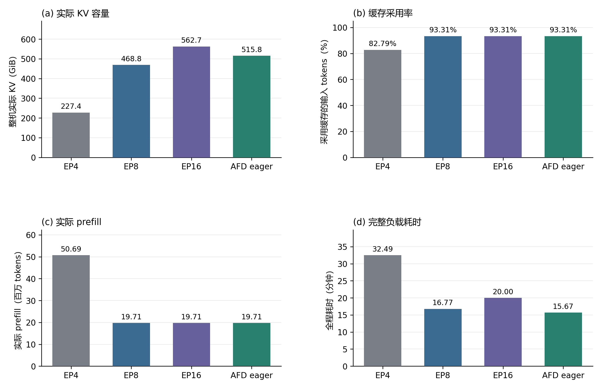
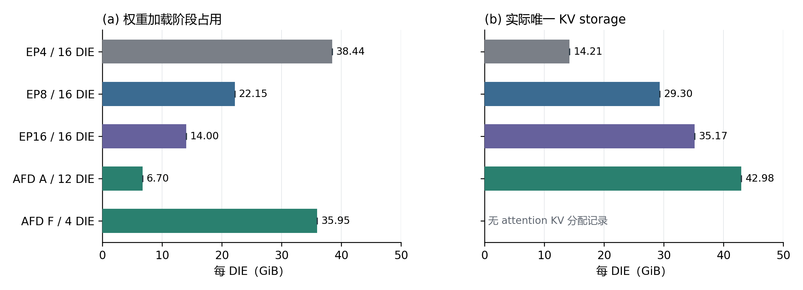

# Prefix-on 收益场景：128 完整会话、C12 四组实验

实验与报告日期：2026 年 10 月 14 日。

**在相同 16 DIE、prefix caching 开启的本次负载下，AFD eager 完成 128 个完整会话耗时 940.08 秒，比 EP4、EP8、EP16 分别少 51.77%、6.54%、21.65%。** 四组各一次完整回放，合计 14,900 条请求全部成功。本次找到了符合目标的实测候选：AFD 对 EP4、EP8 有收益，对 EP16 也没有出现耗时劣势。

AFD、EP8、EP16 的 **3,725 条请求逐条缓存采用完全相同**，实际 prefill 均为 19,710,102 tokens。AFD 对这两组的优势是在等量实际 prefill 下观察到的系统完成效率差异。EP4 实际 prefill 为 50,688,150 tokens，比 AFD 多 30,978,048 tokens，缓存工作量也存在差异。四组均零抢占、零抢占重算；单次结果不代表稳定收益或普遍优势。

## 设计与可比条件

研究目标是在 prefix-on 的条件下，寻找 AFD 优于 EP4、EP8 且不慢于 EP16 的实际工作负载。先用 CPU 缓存模拟筛选候选，再冻结 **源顺序前 128 个完整会话 / 全局 HTTP C12** 进入实测。模拟不预测端到端时长，是否获益以四组设备实测为准。

四组在**同一物理节点、同一 Pod** 上顺序独占 16 DIE，使用相同 DeepSeek-V4-Flash W4A8 模型、tokenizer、公共 vLLM/Ascend 及已验证的 Compressor host 修复。实际正式顺序为 EP8 → AFD eager → EP16 → EP4；每组独立启动/profile、冷缓存 reset，并保存各域原生计数和端点 metrics 基线。每组正式回放一次，没有请求重试或结果拼接，没有 profiler。

| 部署 | 16 DIE 拓扑 | KV 缓存域 | 每域单步 token 预算 MBT | 执行模式 |
| --- | --- | ---: | ---: | --- |
| Non EP4 | 4×DP1/TP4/EP4 | 4 | 8,192 | eager |
| Non EP8 | 2×DP2/TP4/EP8 | 4 | 8,192 | eager |
| Non EP16 | 1×DP4/TP4/EP16 | 4 | 8,192 | eager |
| AFD eager | 12A+4F；A DP3/TP4，F DP4/TP1/EP4 | 3 | 32,768 | A/F eager |

共同参数为 max model length 262,144、block size 32、显存利用率目标 0.9、checkpoint ratio 0.25、prefix caching 和 chunked prefill 开启、每个缓存域最多处理 8 条序列、异步调度开启、OMP4 及原绑核。AFD 保留 CAM 异步通信、两份 token 微批次、F layered GMM=1、共享专家在 A 侧；FlashComm、MC2 和通信缓冲沿用各自既定配置。**这是既定部署的系统比较**：MBT、缓存域数、专家与通信布局随部署变化，没有把这些配置强制为相同，也没有对每组重新调到最优。

软件固定为 vLLM `d02df748bf9efd99022f1a062597dc3cb3808485`；Ascend base `52411eb0dec8b3b3d05e8bdf5a9adb7698fb80c5` 加 PR #4 head `5cfb1697cf570b3bae2e30f9cc76d9e4e8bb5f46` 及已记录补丁；AFD `release/v0.26.0rc2` 的 `cda849a5e0a54576472096c0073f00c7095726f5` 与匹配 CAM/native。各组检查了 16 个 worker 的实际环境、加载算子与修复 host，以及原生异步调度类 `CompressorCheckpointAsyncScheduler`。相对各自已成功 C12 基线，规范化后的服务 argv 无变化，模型与性能参数未调整；允许变化仅为记录位置和恢复后的 Pod/网络身份。[实际配置](../../experiments/2026-10-14-c12-128/recorded-configuration.json)、[配置核对](../../experiments/2026-10-14-c12-128/configuration-comparison.json)、[发压前与加载审计](audits/complete-runs.json)保留公开字段。

## 数据集、会话并行与调度

本轮直接从已发布的 [256 会话冻结负载](../../datasets/frozen-256/README.md) 取源会话 **0–127**，保留每个会话全部轮次和原始请求字节：128 会话、3,725 请求、294,584,470 输入 tokens，每会话 9–75 轮，最大 prompt 216,178 tokens，输出固定 1 token。没有重新分词、截短历史、凑请求数或在实测后按收益挑会话。请求 SHA256 为 `65e10b43838be7bdf1f7459a07d34f1a57b64d05fa75fbf2b94f46efed6e86a4`；[128 会话清单](../../datasets/frozen-128/manifest.json)与[原母集派生方法](../../datasets/frozen-128/README.md)可复核。

128 个会话进入真实 AgentInfer 依赖图。客户端在**已经就绪的请求**中按预先冻结的优先级准入，全局最多保持 **12 条尚未完成的 HTTP/SSE 请求**；这就是 C12。后续轮次必须等本会话前一轮完成，没有新增轮次屏障或人为等待，本轮生成内容不回填下一轮冻结历史。客户端 C12、完整会话数 128、服务端每域最多 8 条序列，分别约束不同层次。

同一会话固定到一个 KV 缓存域，即保存并复用该会话历史的独立调度/缓存单元。按各会话最大历史长度降序、逐个分配给当前累计负载最小的域，事前生成均衡路由。Non 三组共用同一四域映射，每域 32 会话；AFD 三域分别为 43、42、43 会话。EP8 的域对应实例内 DP rank，EP16 的域对应同一实例的 DP rank 0–3。异步调度允许主机提交与设备执行重叠，未取消会话依赖，也不意味着所有域没有等待。

正式耗时从第一条实际 HTTP 发送到最后一条 SSE 完成，覆盖该区间全部依赖与准入等待，不含启动/profile、文件准备及冷 reset。TTFT 从发送前、正文序列化开始前计至首个生成 token；E2E 从相同起点至流完成，均排除请求发送前的依赖和准入等待。[bench 方法](../../docs/bench-method.md)仍适用，本轮并发上限为 C12。

## 四组结果

| 部署 | 全机实际 KV GiB | 输入 token 缓存采用率 | 实际 prefill tokens | 全程秒 | 全程分钟 |
| --- | ---: | ---: | ---: | ---: | ---: |
| Non EP4 | 227.363 | 82.7933% | 50,688,150 | 1,949.28 | 32.488 |
| Non EP8 | 468.826 | 93.3092% | 19,710,102 | 1,005.92 | 16.765 |
| Non EP16 | 562.681 | 93.3092% | 19,710,102 | 1,199.91 | 19.998 |
| **AFD eager** | **515.770** | **93.3092%** | **19,710,102** | **940.08** | **15.668** |

全机 KV 为实际独立 tensor storage 之和，包含各 TP DIE 的驻留副本；缓存采用率是采用缓存的输入 tokens / 全部输入 tokens，并非命中请求比例。实际 prefill 来自服务端原生 `request_finished`，逐条与 HTTP usage 匹配。四组均满足 `输入 tokens = 采用缓存 tokens + 实际 prefill tokens`，没有抢占重算。[完整指标](metrics.csv)和[逐域容量](per-domain-capacity.csv)保留未舍入值。

图 1｜相同输入与资源预算下的四组实测。[矢量版](figures/fig01_four_arm_overview.svg)、[作图数据](figures/four-arm-figure-data.csv)。

AFD 相对 EP4、EP8、EP16 的时长缩短为 **51.77% / 6.54% / 21.65%**，对应全程加速约 **2.074× / 1.070× / 1.276×**。时长缩短采用 `1−AFD耗时/对照耗时`，没有与吞吐增长百分比混用。

## 显存与缓存工作量如何影响收益

| 部署/角色 | DIE 数 | 每 DIE 权重加载占用 GiB | 每 DIE 实际 KV GiB | 每 DIE profile 后 HBM 已用 GiB |
| --- | ---: | ---: | ---: | ---: |
| EP4 | 16 | 38.4446 | 14.2089–14.2119 | 56.9238–57.1914 |
| EP8 | 16 | 22.1503 | 29.2999–29.3044 | 55.7930–56.0771 |
| EP16 | 16 | 14.0032 | 35.1668–35.1691 | 53.5762–53.8438 |
| AFD A | 12 | 6.6995 | 42.9804–42.9819 | 55.5557–55.8223 |
| AFD F | 4 | 35.9467 | 无 attention KV 分配记录 | 53.5928–53.8545 |

权重为加载日志报告值，源码使用 bytes/2³⁰，本报告按 GiB 记录。权重加载、KV 分配和 HBM 快照属于不同记录阶段，不能直接相减得到精确的工作区占用。F 的未知 profile 分项保留为空，不填成测得的零；完整 64 DIE 的分项与原值见[逐 DIE 显存](per-die-memory.csv)。

图 2｜每 DIE 均值，细线表示本组最小至最大范围；两个阶段分开显示。[矢量版](figures/fig02_per_die_memory.svg)。

AFD 相对 EP4、EP8 减少专家权重的重复驻留，为 A 侧留下更大的单 DIE KV 空间。在本次实测中，EP4 有 **466 条请求**采用缓存少于 AFD，其余请求相同；总计多做 **30,978,048** 个 prefill tokens，约为 AFD 实际 prefill 的 **157.17%**。容量压力与这项额外工作量相符，但专家布局、通信和组批也随部署变化，不能将全部 51.77% 时长缩短精确归给缓存。

EP8、EP16 则与 AFD 的 **每一条请求**输入及缓存采用均相同，并非仅总命中率碰巧一致。EP16 比 AFD 多 **46.91 GiB** KV，本次没有因此少做 prefill。于是，AFD 在保有对 EP4 缓存工作量优势的同时，没有承担相对 EP16 的额外 prefill。对 EP8、EP16 的收益体现为当前配置完成相同实际 prefill 的系统效率差异；等量 token 仍不等于完全相同的 FLOPs、批形状或执行轨迹。

这也说明容量优势是否兑现取决于工作集。此前 [256 会话 / C16 五组实验](../2026-10-12-ep16/REPORT.zh-CN.md)中，EP16 比 AFD 少做 31,391,744 个 prefill tokens，并且完成更快。本轮不改写旧结论：负载、并发和对子集重建的路由均已变化，无法把收益反转归结为“只调小 C”或单一缓存阈值。两组实验共同显示，AFD 的收益需要结合历史复用压力和实际执行效率判断。

## 请求延迟与可观察的等待

| 指标 | Non EP4 | Non EP8 | Non EP16 | AFD eager |
| --- | ---: | ---: | ---: | ---: |
| 吞吐，请求/秒 | 1.911 | 3.703 | 3.104 | **3.962** |
| TTFT 均值，秒 | 6.239 | 3.171 | 3.793 | **2.936** |
| TTFT P50，秒 | 2.722 | 2.831 | 3.486 | **2.531** |
| TTFT P95，秒 | 24.768 | 6.532 | 6.676 | **6.361** |
| TTFT P99，秒 | 39.354 | 9.552 | 8.743 | **8.611** |
| E2E 均值，秒 | 6.240 | 3.174 | 3.797 | **2.939** |
| 平均在途 HTTP 请求数 | 11.925 | 11.754 | 11.787 | 11.646 |

AFD 在这一次试验的均值和所列分位数均更低，C12 下各组平均在途请求均接近上限。不过各组请求共享调度与缓存状态，3,725 条请求不能充当 3,725 次独立试验；尾部的细小差距没有重复运行确认。

原生 metrics 相对各域冷基线的增量给出以下请求平均阶段值：

| 部署 | 等待首次调度 WAITING，秒 | 首次调度至生成结束 RUNNING，秒 | 客户端 E2E 两段之外，秒 |
| --- | ---: | ---: | ---: |
| Non EP4 | 1.9097 | 3.7930 | 0.5378 |
| Non EP8 | 0.1354 | 2.2086 | 0.8301 |
| Non EP16 | 0.1085 | 2.5803 | 1.1080 |
| AFD eager | 0.0041 | 2.2039 | 0.7310 |

AFD 与 EP8 的平均 RUNNING 接近，AFD 的首次调度前等待更短；EP16 的平均 RUNNING 与客户端残差都更长。这些是定位后续问题的观测，并未证明具体责任组件。RUNNING 包含组批、计算、通信和执行期间等待，残差也包含多种客户端/服务链路开销，均不能直接叫作纯设备计算或单一主机开销。上述请求平均值不能分解有重叠的全程耗时。本轮未新增 profiler，也未据此修改同步逻辑。[原生统计与口径](native-metrics.json)保留原始增量与限制。

## 模拟筛选与实测的一致性

| 部署 | 模拟 prefill | 实测 prefill | 实测减模拟 | 缓存不同的请求数 |
| --- | ---: | ---: | ---: | ---: |
| Non EP4 | 45,760,662 | 50,688,150 | +4,927,488 | 109 |
| Non EP8 | 19,710,102 | 19,710,102 | 0 | 0 |
| Non EP16 | 19,710,102 | 19,710,102 | 0 | 0 |
| AFD eager | 19,710,102 | 19,710,102 | 0 | 0 |

AFD、EP8、EP16 的逐请求缓存预测全部复现；EP4 实测 prefill 比预测高 **10.77%**。模拟使用原生异步 checkpoint 调度类，但采用立即回调和各域等步推进，未仿真真实设备、通信、HTTP 和跨域推进时间。自然 profile 的容量也有少量 block 变化，因此不能把 EP4 误差单独归给容量或顺序。模拟支持缓存工作量筛选，其压力区间结果和端到端收益仍需实测。[模拟与实测对照](simulation-vs-actual.json)保留逐域 N/B、布局一致性及逐请求差异数量。

## 复核结论与边界

这次比较的负载身份、完整会话、模型/软件、16 DIE 资源、C12、会话依赖、冻结优先级、亲和落点、有效异步调度与原生计数均通过核对；未发现影响本次既定部署比较的执行或配置偏差。结果支持：**在本次 prefix-on、128 完整会话、C12 的 workflow 下，AFD eager 同时优于 EP4、EP8、EP16。** 原始 [256 会话结果](../2026-10-12-ep16/README.md)独立保留，未被替换或合并。

适用边界仍然明确：每组一次、固定顺序，同机排除了跨机器差异，但没有通过反顺序重复排除时间与系统波动；尤其对 EP8 的 6.54% 收益还不能称稳定。MBT、域数、通信与动态组批没有做因素隔离，也未证明各 Non 拓扑已达到最优。此次精度检查沿用既定版本证据，并验证实际加载身份、输出 token 与流完整性，没有新增全面数值精度评测。[review.json](review.json)记录设计审阅、数据证据与限制。

发布前还核对了准备清单：其中几项描述性的 selection、coverage、length distribution 字段继承了母集统计。原始清单保留；公开 128 会话清单依据完整索引与已发布母集的原始行重算，正文、输入哈希、优先级、路由、发压参数和性能记录均未改变。

四次正式回放各完成一次。首次 AFD 在发压前因沿用旧记录用途断言失败，0 条正式请求；仅修正记录断言后，经离线检查并获用户明确批准补跑一次，成功 AFD 使用新 run ID v2。失败记录独立保留。首个模型启动至最后服务清理 **118.61 分钟**，未超过原 135 分钟预算。[运行历史](run-history.json)、[成本审计](cost-audit.json)与[证据包身份](evidence-archive.json)可追溯。清理时自有模型/回放进程已停止，任务与数据按约定保留；此记录不代表资源当前状态。

公开材料包括 14,900 条数值请求、29,800 条准入/完成事件、64 DIE 显存、15 域容量、冻结索引/路由、实际配置和审计；机器日志、完整环境、模型和 native 二进制不随 Git 发布。所有公开文件与原来源的 SHA256/字段变换见 [sources.json](sources.json)。可直接离线复核：

~~~bash
python3 scripts/recompute_results.py --result-set 2026-10-14-c12-128
~~~

报告同时提供 [PDF](REPORT.zh-CN.pdf)、[自包含 HTML](REPORT.zh-CN.html)与[证据索引](README.md)。本次仓库整理只做文档、图表和离线验证，没有新增设备回放。
